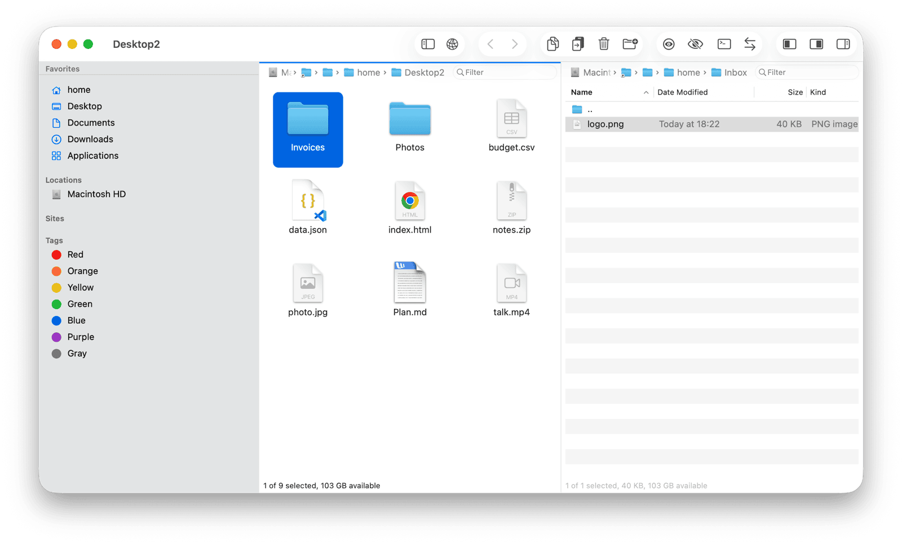
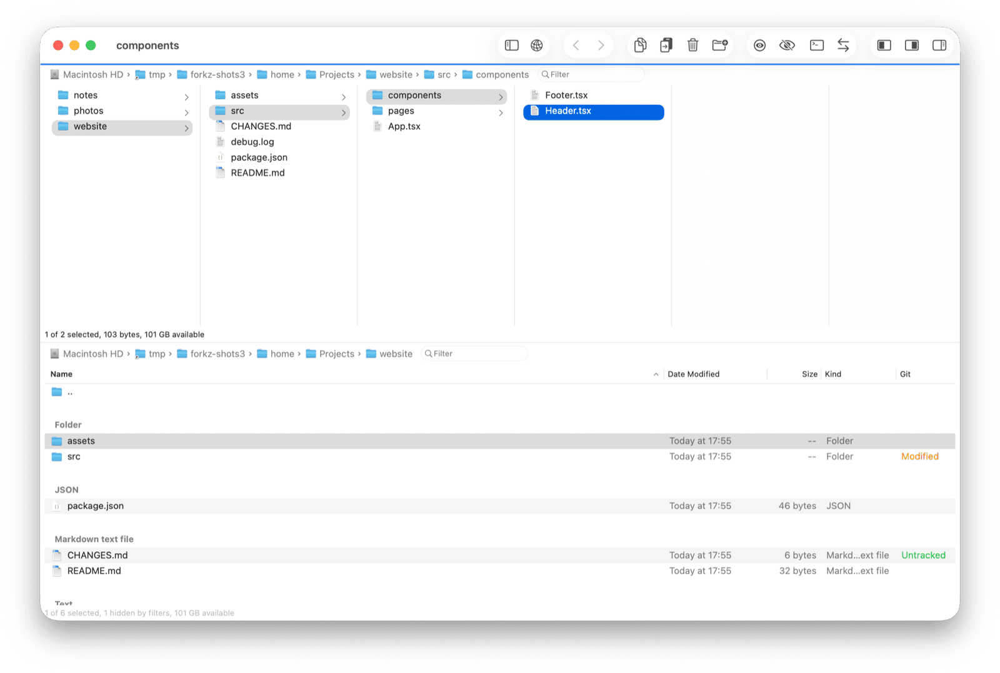
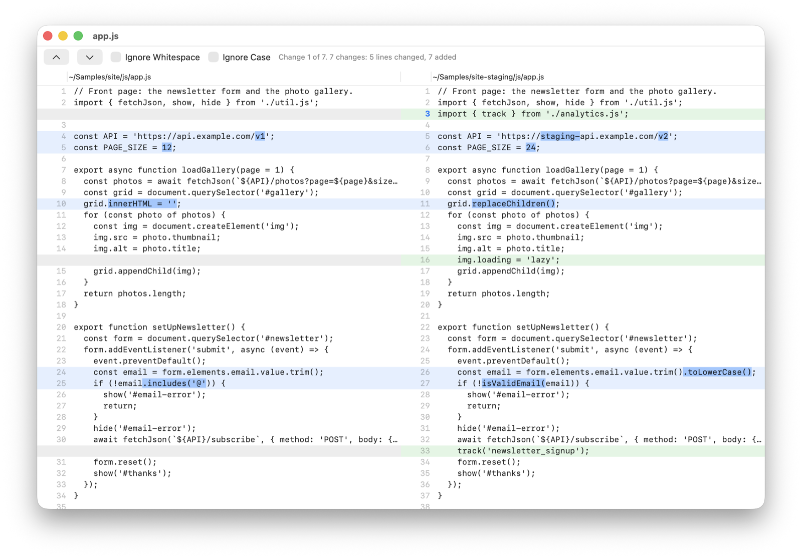
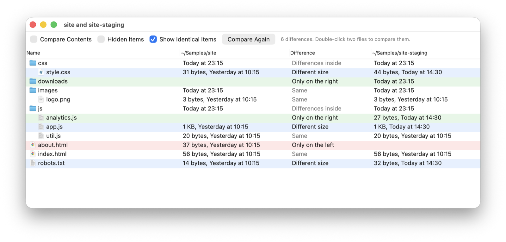
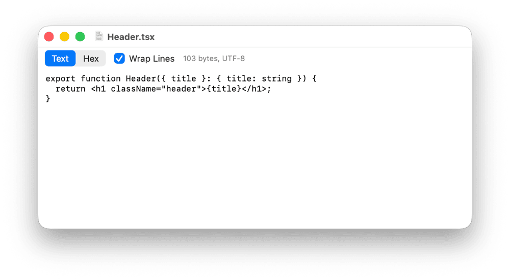
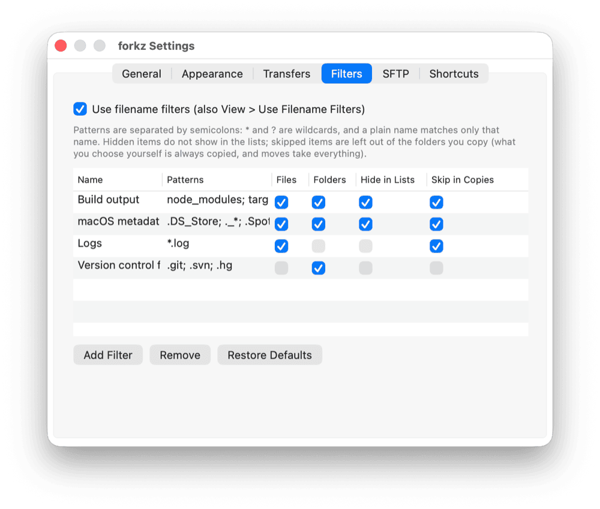
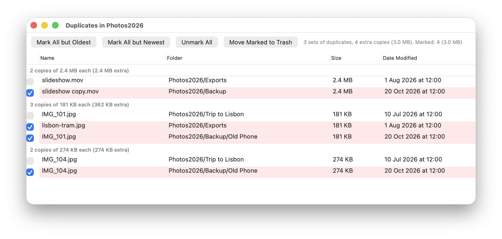

# forkz

A fast, native dual-pane file manager for macOS on Apple silicon, written in Rust with AppKit.


**[Download the latest release](https://github.com/houseofmackee/forkz/releases/latest)** (Apple silicon, macOS 14 or later): signed with a Developer ID, notarized by Apple, and it updates itself. Or install it with Homebrew: `brew install --cask houseofmackee/tap/forkz`.

**Status:** early development. The local dual-pane file manager, SFTP, FTP and FTPS, WebDAV, S3, and SMB, AFP, and NFS shares work; cloud drives come later. See [PLAN.md](PLAN.md) for what is done and what is planned, and [CHANGELOG.md](CHANGELOG.md) for what changed in each release.

## Features

### Two panes, on the Mac and on servers

- Two panes side by side, or stacked one above the other (View > Stack Panes), each with tabs, and a sidebar with favorites, smart folders, volumes, saved sites, synclets, and Finder tags. The sidebar, either pane, and the preview pane can each be hidden.
- A line in your accent color along the top of the active pane shows where commands, new connections, and Go to Folder will open. Tabs show a close button when the pointer is over them.
- A sortable list (name, date modified, size, kind, Git status, and more) with ".." on top to go up, groups by kind, date, or size, a clickable path bar, a filter field, and a status line with the selection size and free space; or icons, or columns, as in Finder
- A viewer for text and hex (F3), and filename filters that hide items in the lists and leave them out of copies
- Copy, move, duplicate, trash, rename, new file, and new folder, with progress, Stop, Pause, and a conflict dialog (Replace, Replace if Older, Keep Both, Skip, Merge, and "Apply to all")
- Fast copies on APFS (clones), drag and drop with Finder, and Copy and Paste of files
- Quick Look, a hidden files toggle, and live updates when folders change
- Flat View (Option-Command-F): every file in a folder and the folders in it, in one list
- Reopen Closed Tab (Shift-Command-T), Move Tab to Other Pane, Select Same Type, and the mouse's Back and Forward buttons
- Go > Recent Folders: the folders you were in lately, on the Mac and on servers
- Moving an app to the Trash offers to remove the settings, caches, and support files it left in your Library folder
- Sounds as in Finder for moving items to the Trash and deleting them, and a chime when a long transfer finishes (or a different sound if something failed); they follow macOS's "Play user interface sound effects" setting and can be turned off in Settings > General
- Folder sizes, checksums (MD5, SHA-1, SHA-256, SHA-384, and SHA-512), Export Folder Tree (a text listing of a folder and everything in it), a built-in compare for files and folders (or your own diff tool), Compare Panes, and Open in Terminal with your terminal app
- Workspaces: saved sets of tabs for both panes, including server folders
- A transfer queue: speed limits, Pause and Resume, Pause All and Stop All, and waiting transfers that can be started now or moved up and down (right-click a transfer), plus rules for errors
- Zoom (Command-= and Command-minus) and a Settings window (Command-comma) with color themes, text size, row spacing, and your own keyboard shortcuts
- Optionally used for "Show in Finder" in other apps (Settings > General): the file opens selected in forkz. macOS keeps Finder as the app that opens folders, but forkz can open them with Open With

### Icons, columns, Group By, and Git status





Each pane shows a list (Command-1), icons (Command-2), or columns (Command-3), as in Finder. Icons grow with the text size (zoom); in column view, choosing a folder opens its contents in the next column, and the arrow keys browse. In every view, commands, Quick Look, the preview pane, and drag and drop work as in the list: drag items out to another pane or to Finder, or drop them on a folder (or a column or the view itself) to copy or move them there. View > Group By groups the list by kind, date modified (Today, Yesterday, Previous 7 Days, and so on), or size, keeping the sort within each group. View > Stack Panes puts the panes one above the other.

In a Git repository, the Git column (View > Columns) shows whether each item is modified, added, untracked, renamed, ignored, or in conflict; a folder shows the most important change inside it. It uses Homebrew's git, or Apple's when the command line tools are installed.

### Preview pane and archives


The preview pane (Shift-Command-P) shows Info, a Quick Look preview, the session's transfers, and a log. It can expand to fill the window (Control-Command-P) and shrink back. For an archive it lists what is inside.

Archives (zip, tar, 7z, rar, iso, and more) open like folders: copy items out to extract them, on the Mac or on a server. Zip, tar (plain, gzip, bzip2, or xz), and 7z archives on the Mac can also be changed in place: copy or drag items into them, rename and delete items, and make folders. Other formats, and archives on servers, are read-only. Compress makes zip, tar.gz, 7z, and other archives.

### Rename Multiple Items


Select several items and press Return (or Option-Command-R). Rules (replace, regular expressions, insert, remove, case, numbers, and dates) stack, the preview shows every new name and any problems before anything changes, and presets keep rule sets for next time. Saved presets also appear in the sidebar: drop files on one, or click it, to rename the selection with it.

### Search


Search (Shift-Command-F) finds items by name or contents, by kind (folders, images, movies, audio, documents, archives, source code, and more), and by Finder tag, or any mix of these. It uses Spotlight on the Mac and also works on servers and in archives. The results open in a pane, with a column for the folder each one is in, and work like any other list.

A search on the Mac can be saved as a smart folder ("Save as a smart folder in the sidebar"): clicking it in the sidebar searches again and shows what it finds now. Right-click a smart folder to change its search, rename it, or delete it.

### Compare files and folders



Compare Files (Control-Command-C) compares two selected files, or one selected in each pane, in a window of its own: side by side, line by line, with changed lines in blue (and the words that changed marked), removed lines in red, and added lines in green. Command-Down Arrow and Command-Up Arrow move to the next and previous change, and whitespace or case can be ignored. Binary files are compared byte by byte. It works on the Mac, on servers, and in archives.



Two folders are compared with everything in them: what only one side has, what differs in size or date (or in contents, with Compare Contents), and what is the same. Double-click two files to compare them. Settings > General can send Compare Files to FileMerge, Kaleidoscope, Beyond Compare, BBEdit, Visual Studio Code, or Araxis Merge instead.

Compare Panes (Commands menu) selects, in each pane, the items that differ from the other pane: what the other pane does not have, files that are newer, and files of the same date but a different size. Copy the selection over to bring the folders in line.

### Sync Folders and synclets


Sync Folders (Shift-Command-S) compares the two panes' folders, on the Mac or on servers, and shows what would be copied or deleted and why, before anything happens. Any item can be left out. It syncs one way or both ways, with options for subfolders, hidden items, new and changed items, empty folders, deleting what only the target has (off unless chosen), a time offset for servers whose clocks differ, and names to skip.

A sync can be saved as a synclet in the sidebar: clicking it connects to its sites if needed and compares right away. Sync Browsing (Shift-Command-B) keeps the other pane in the matching folder while you browse.

### Transfer queue


Transfers beyond the simultaneous limit (Commands menu, default 2) wait in a queue, each showing its place in line. Right-click a transfer to start it now, move it to the top, up, down, or to the bottom, pause it, or stop it. With several transfers, a line above them shows how many are waiting, with Pause All (or Resume All) and Stop All. Speed limits for uploads and downloads, and what to do on errors, are in Settings > Transfers.

### Command palette


The command palette (Option-Command-P) runs any command and goes anywhere: places, favorites, recent folders, devices, sites, server folders, synclets, smart folders, and workspaces. It also applies rename presets to the selection and opens the selected file with any app that can open it.

### Color themes


Settings > Appearance has a theme for the file lists and the sidebar: macOS's own colors (light, dark, or following macOS), or one of the built-in themes, such as GitHub Light, Solarized, Catppuccin, Dracula, Nord, One Dark, Monokai, Gruvbox, and Tokyo Night. Customize… turns the chosen theme into one of your own, with a color well for each color.


Your themes are TOML files in the themes folder (`~/Library/Application Support/forkz/themes`), so they can also be written by hand or shared:

```toml
name = "Sunrise"
dark = false
background = "#fdf6e3"
alternate = "#eee8d5"
text = "#586e75"
secondary = "#93a1a1"
selection = "#268bd2"
selection_text = "#fdf6e3"
accent = "#b58900"
sidebar = "#eee8d5"
```

### Viewer



View (F3) opens a file in a window of its own, on the Mac, on a server, or in an archive: as text (UTF-8, UTF-16, or Latin-1, with Command-F to search and optional line wrapping) or as hex, with offsets and characters. Files that look binary open in hex. Up to 64 MB of a file is read.

### Filename filters



Filters are named sets of patterns, such as `node_modules; target; *.o`, as in FileZilla. Each can hide matching items in the lists, leave them out of the folders you copy (uploads and downloads included), or both, and apply to files, folders, or both. Settings > Filters edits them and comes with a few to start from; View > Use Filename Filters turns them all on or off, and the status line says how many items they hide. Items you choose yourself are always copied, and moves take everything, so nothing is left behind.

### Find Duplicates



Find Duplicates (Commands menu) looks through a folder on the Mac and everything in it for files with the same contents (by size, then by SHA-256), and lists them in groups, the ones that take the most space first. Mark copies by hand, or all but the oldest or newest of each group, and move them to the Trash; one copy of each file is always kept. Double-click a file to show it in the pane.

### Finder tags and Select Matching

- Tags show as colors on file icons; Tags… edits them, and a tag in the sidebar finds everything with it.
- Select Matching (Option-Command-A) selects items by name pattern, and can add them to the selection or remove them from it.

### Shortcuts and forkz:// links

forkz has actions in the Shortcuts app: Open in forkz (a folder, or a file selected in its folder, in either pane or a new tab), Connect to Site in forkz, Search in forkz, Open Synclet, Open Smart Folder, Open Workspace, and Run forkz Command (Compare Panes, Find Duplicates, Flat View, and the other menu commands; commands that delete or move items are not offered). Saved sites, synclets, smart folders, and workspaces can be picked from a list.

The same things work as `forkz://` links, for scripts, launchers such as Raycast and Alfred, and web pages (`open "forkz://..."` in Terminal, or `forkz 'forkz://...'` from the command line). Values are percent-encoded (a space is `%20`):

| Link | Does |
| --- | --- |
| `forkz://open?path=~/Downloads` | Shows a folder (or a file, selected) in the active pane; add `pane=left`, `right`, or `other`, and `tab=new` |
| `forkz://connect?site=Staging&path=/var/www` | Connects to a saved site (by name), optionally in a folder |
| `forkz://search?path=~/Documents&text=invoice&kind=documents` | Searches a folder (`kind`: folders, files, images, movies, audio, documents, archives, or code; `contents=1` searches inside files) |
| `forkz://synclet?name=Website` | Opens a synclet and compares its folders |
| `forkz://smart-folder?name=Photos` | Opens a smart folder |
| `forkz://workspace?name=Work` | Opens a workspace |
| `forkz://command?name=ComparePanes` | Runs a command by its id, such as `ComparePanes`, `FindDuplicates`, `FlatView`, `SwapPanes`, or `SyncFolders` (Run forkz Command in Shortcuts lists them all) |

## SFTP

- **Connect** with File > Connect to Server (Command-K), the toolbar, a saved site in the sidebar, Go to Folder, the command palette, or `forkz sftp://user@host:port/path`.
- **Log in** with a password (also keyboard-interactive), a private key file (asks for its passphrase), or the SSH agent. With nothing saved, keys from the agent and `~/.ssh` are tried before asking for a password.
- **Host keys** are checked against `~/.ssh/known_hosts` and keys you trusted in forkz. A new server asks you to compare the SHA256 fingerprint; a changed key gets a strong warning.
- **Sites** keep the server, login, a remote folder to open, and a local folder for the other pane. Passwords are kept in your login Keychain, never in a file. Connected sites show a green icon and an eject button in the sidebar.
- **Transfers** between the Mac and a server, or between two servers, run on their own connection with progress, Stop, and Pause, keep modification dates, and replace files only once the new copy is complete. Drag and drop works between panes and from Finder.
- **On the server:** browse, rename, new folder, delete (asks first: servers have no Trash), open a file (saving it uploads it back), Copy Server Link (an `sftp://` link), and Open in Terminal (an SSH session in that folder).
- **`~/.ssh/config`** hosts work anywhere a server name goes (HostName, User, Port, IdentityFile, IdentitiesOnly, ProxyCommand, ProxyJump, wildcards, Include); the Connect form lists them. ProxyJump uses the system `ssh` for the jump hosts (key or agent login).
- **Permissions, Owner, and Group** columns; Permissions… (Command-I) changes permissions, optionally for everything inside a folder.
- **Columns** are chosen by right-clicking the column titles or with View > Columns, separately for the Mac and for servers.
- **Simultaneous transfers** (Commands menu, default 2): more uploads and downloads wait their turn. Right-click a transfer to start it now or move it up or down the queue; with several, Pause All and Stop All appear above them.
- Dropped connections reconnect by themselves.
- **Interrupted transfers resume** from their partial file, if the original has not changed since.
- **Drag to Finder:** files and folders dragged from a server pane download where you drop them.

## FTP, WebDAV, S3, and network shares

Choose the protocol in Connect to Server; sites keep it.

- **FTP and FTPS:** encrypted with TLS when the server offers it (the default), TLS required, or plain FTP. Certificates are checked by macOS; a self-signed one shows its fingerprint to trust once. Passive mode, MLSD listings where available, and resumed transfers.
- **FXP:** copies between two FTP servers go straight from one server to the other when both allow it, without passing through your Mac (the activity shows "server to server"). Many servers refuse this; forkz checks once per pair of servers and otherwise copies through the Mac as usual. With FTPS, one of the servers must support SSCN; FXP is never used when only one of the two connections is encrypted.
- **WebDAV** over HTTPS or HTTP, with Basic login. Put the server's WebDAV path in Remote folder (for Nextcloud, `/remote.php/dav/files/USER`).
- **S3 and S3-compatible storage:** the access key ID goes in User and the secret key in Password (kept in the Keychain). The top level lists your buckets. The region comes from an AWS server name (`s3.eu-west-1.amazonaws.com`); for other providers, set it in Region (Cloudflare R2 uses `auto`). Files up to 5 GB; folders can be created and deleted, files renamed.
- **SMB, AFP, and NFS** shares are mounted by macOS, as in Finder (its sign-in and share-picker dialogs included), and browsed like folders on the Mac. Put the share in Remote folder (for example `Public` or `Public/Photos`), or leave it empty to choose. A share that is already mounted is used as it is. Disconnect (Command-E) unmounts the share.
- Addresses work in Go to Folder and on the command line: `sftp://`, `ftp://`, `ftps://`, `dav://`, `davs://`, `s3://`, `smb://`, `afp://`, and `nfs://`.

### Importing from FileZilla

File > Import from FileZilla reads `~/.config/filezilla` and shows what it found before changing anything:

- Sites from the Site Manager (SFTP, FTP, FTPS, S3, and WebDAV), with their folders, saved passwords (into the Keychain), key files, and default remote and local folders
- The host keys FileZilla trusts, so known servers do not ask again
- Settings forkz has an equivalent for: show hidden files, keeping modification dates, what to do when a file exists on download or upload, the number of simultaneous transfers, the connection timeout, and extra key files

Sites using implicit FTPS (port 990) or protocols forkz does not have, and passwords protected by a FileZilla master password, are listed as not imported. FileZilla's files are not changed.

### Other apps, and moving sites to another Mac

- File > Import from Cyberduck reads Cyberduck's bookmarks (SFTP, FTP, FTPS, WebDAV, S3, and SMB, with their folders and key files).
- File > Import from WinSCP reads a `WinSCP.ini` (in WinSCP on Windows: Tools > Export/Backup Configuration), with its folders.
- File > Export Sites saves your sites to a file, and File > Import Sites from File brings them in on another Mac. Passwords are not included: forkz asks for them when connecting.

Sites forkz already has are left as they are. Transmit's exports are in a private format, so its servers cannot be imported.

## Custom tools

Settings > Tools holds your own commands, run by zsh in the pane's folder on the selection: from Commands > Tools, the toolbar (View > Customize Toolbar, with an SF Symbol as the icon), or the command palette. In a command, `{selection}` is the selected items (or the folder if none are selected), `{file}` the first one, `{names}` their names, `{folder}` the pane's folder, and `{other-folder}` and `{other-selection}` the other pane's; paths are quoted for the shell. The same are in the environment as `FORKZ_SELECTION` (one path a line), `FORKZ_FOLDER`, and `FORKZ_OTHER_FOLDER`. A tool can show what it printed when it is done; if it fails, forkz shows its error output. Stop in the activity area ends a tool that runs too long. A few examples come with forkz:

| Tool | Command |
| --- | --- |
| Make Executable | `chmod +x {selection}` |
| Count Lines | `wc -l {selection}` (shows the output) |
| Disk Usage | `du -sh {selection}` (shows the output) |

## Keyboard

| Key | Action |
| --- | --- |
| Tab | Switch to the other pane |
| Return or F2 | Rename (several items: Rename Multiple Items) |
| Command-Down or Command-O | Open |
| Option-Command-O | Open with the default app |
| Command-Up, or open ".." | Enclosing folder |
| Command-[ and Command-] | Back and forward |
| Command-R | Refresh |
| Space or Command-Y | Quick Look |
| F3 | View (text or hex) |
| F5 or Shift-Command-C | Copy to the other pane |
| F6 or Shift-Command-M | Move to the other pane |
| Command-C, Command-V, Option-Command-V | Copy items, paste items, move items here |
| Option-Command-C | Copy Path (on a server: Copy Server Link) |
| F7 or Shift-Command-N | New folder |
| Option-Command-N, Control-Command-N | New file, new folder with the selection |
| Command-D | Duplicate |
| F8 or Command-Delete | Move to Trash |
| Option-Command-Delete | Delete immediately |
| Option-Command-R | Rename multiple items |
| Command-A | Select all items |
| Option-Command-A | Select matching items |
| Option-Command-F | Flat view (again: back to the folder) |
| Command-F | Filter the list |
| Shift-Command-F | Search |
| Option-Command-P | Command palette |
| Shift-Command-S, Shift-Command-B | Sync folders, sync browsing |
| Shift-Command-G | Go to folder |
| Shift-Command-H, Shift-Command-D, Shift-Command-O, Option-Command-L, Shift-Command-A | Home, Desktop, Documents, Downloads, Applications |
| Shift-Command-R | Show in Finder |
| Option-Command-T | Open in Terminal |
| Control-Command-T | Add to the sidebar |
| Command-U | Swap panes |
| Option-Command-= | Same folder in the other pane |
| Command-K, Command-E | Connect to a server, disconnect |
| Command-I | Permissions |
| Option-Command-S | Calculate folder sizes |
| Control-Command-C | Compare files or folders |
| Command-Down Arrow, Command-Up Arrow | Next change, previous change (when comparing files) |
| Shift-Command-. | Show or hide hidden files |
| Command-1, Command-2, Command-3 | Show as a list, as icons, as columns |
| Shift-Command-P | Show or hide the preview pane |
| Control-Command-P | Expand the preview pane to fill the window, or shrink it back |
| Control-Command-S | Show or hide the sidebar |
| Option-Command-1, Option-Command-2 | Hide or show the left pane, the right pane |
| Control-Shift-Command-S, Control-Command-1 to 9 | Save a workspace, open a workspace |
| Command-=, Command-minus, Command-0 | Zoom in, zoom out, actual size |
| Command-T, Command-W | New tab, close tab |
| Shift-Command-T | Reopen the last closed tab |
| Control-Tab, Control-Shift-Tab | Next tab, previous tab |
| Command-comma | Settings |

Settings > Shortcuts changes any of the menu shortcuts.

## Requirements

- macOS 14 or later
- Apple silicon

## Building

```sh
cargo run                # run from source
cargo test               # unit tests
scripts/test_sftp.sh     # live SFTP tests against a throwaway local sshd
scripts/test_protocols.sh  # live FTP/FTPS, WebDAV, and S3 tests against throwaway local servers (Python)
scripts/bundle.sh        # dist/forkz.app with Sparkle, signed (Developer ID if available)
scripts/make_icon.sh     # macos/AppIcon.svg to AppIcon.icns (needs librsvg)
```

Building needs Xcode (or its command line tools with the macOS SDK): the Shortcuts actions in `macos/Intents` are Swift, compiled into the app by `build.rs`, and `scripts/bundle.sh` adds the metadata Shortcuts reads. `FORKZ_NO_INTENTS=1 cargo build` leaves them out.

## Releasing

Pushing a version tag (`git tag v0.1.0 && git push origin v0.1.0`) runs the Release workflow: it builds forkz, signs it with the Developer ID, notarizes it, and publishes it as the latest release with the DMG, zip, checksums, and a signed `appcast.xml` (so Sparkle offers it right away), then updates the Homebrew cask. The steps are in [docs/RELEASE_CHECKLIST.md](docs/RELEASE_CHECKLIST.md).

```sh
scripts/dist.sh          # the release files in dist/ (FORKZ_SPARKLE_KEY signs the appcast)
```

## License

Licensed under either of [Apache License, Version 2.0](LICENSE-APACHE) or [MIT license](LICENSE-MIT) at your option.
